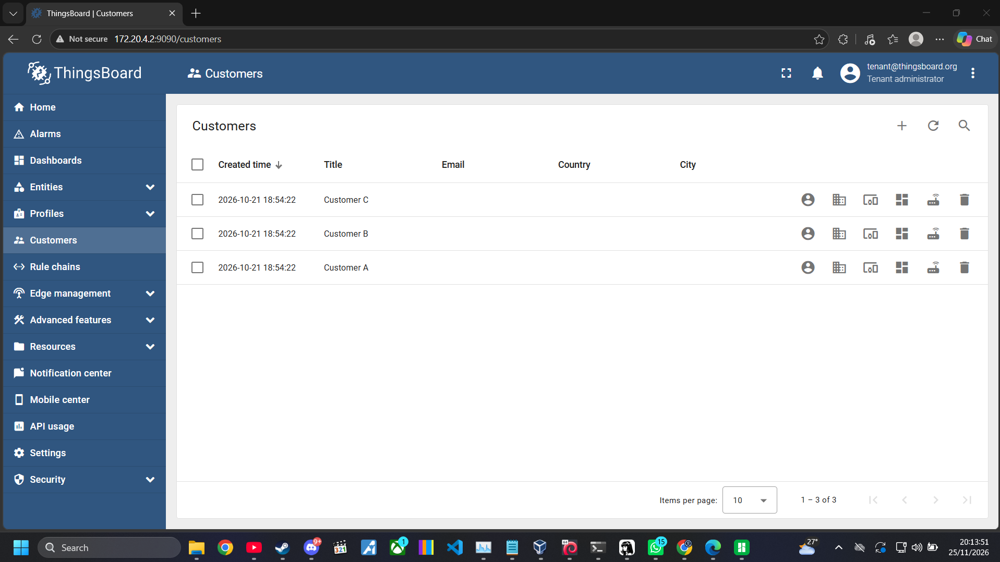
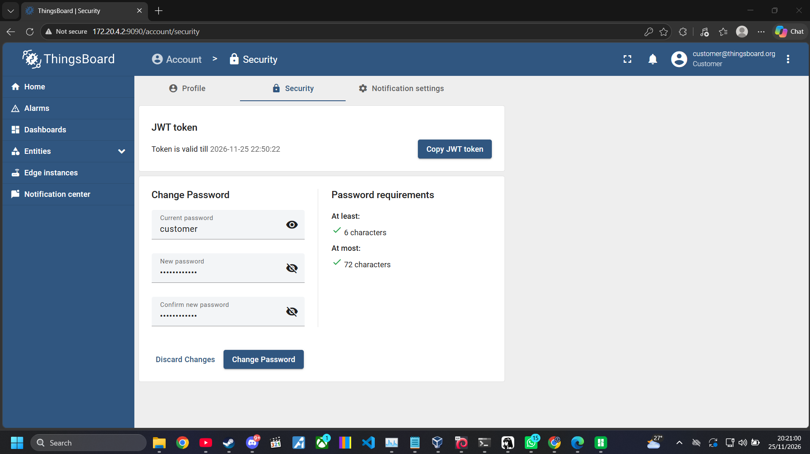
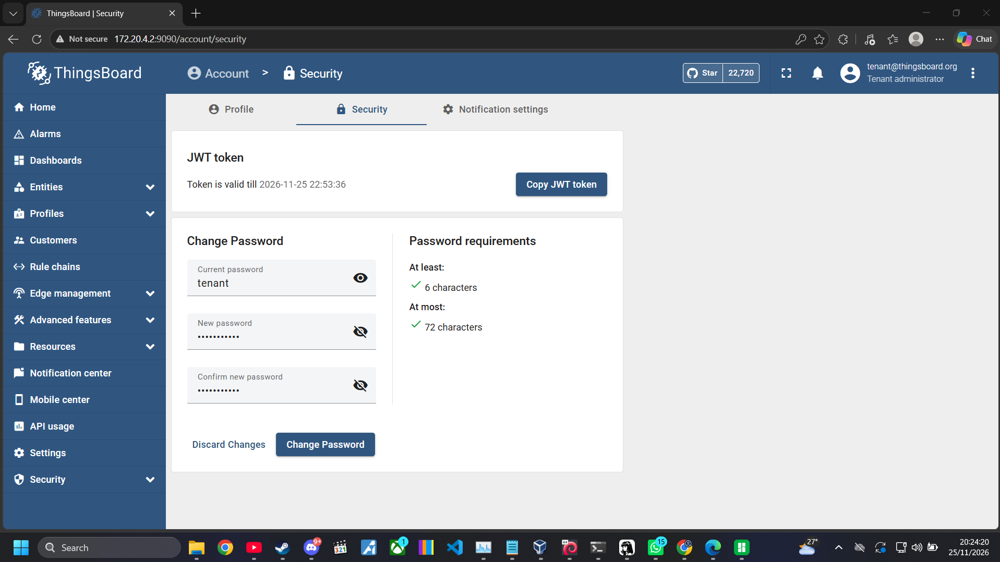

# Hapus/ganti akun & kredensial default ThingsBoard

> Dikonversi dari `Ubah akun default.docx` (dump/blueteam/evidence) ke markdown.

Akun customer before

After (email hanya tersisa customer@thingsboard.org yang diganti passwordnya)

Admin before and after

Tenant before and after

