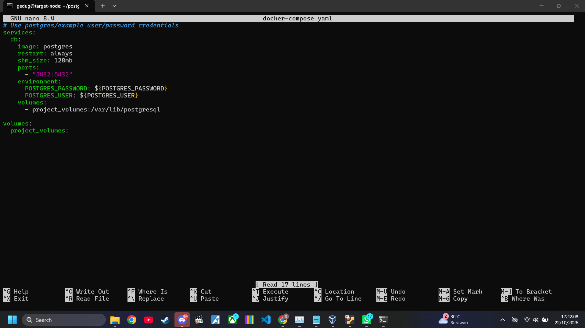
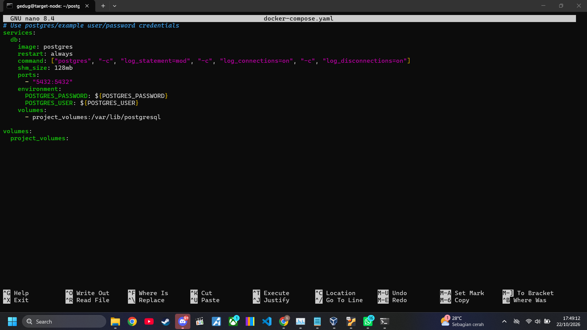
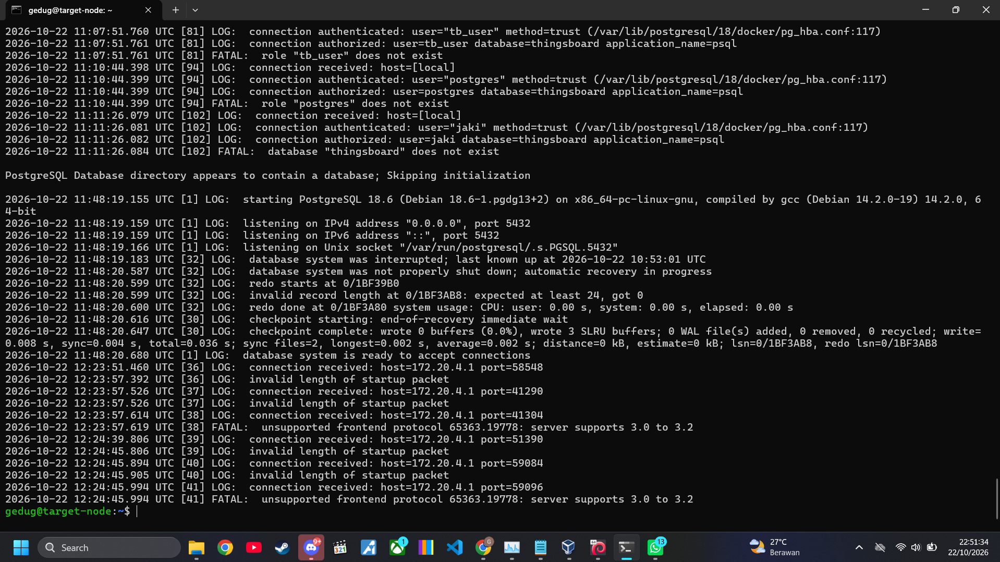

# Logging aktivitas mencurigakan diaktifkan

> Dikonversi dari `{fname}` (dump/blueteam/evidence) ke markdown.

Enkripsi/kredensial tidak hardcoded (env var/secrets)

Logging aktivitas mencurigakan diaktifkan

